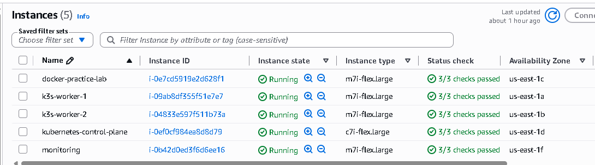
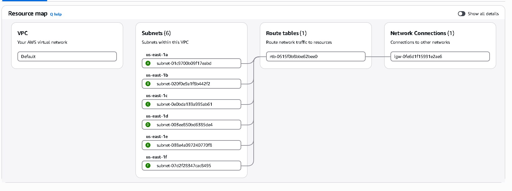
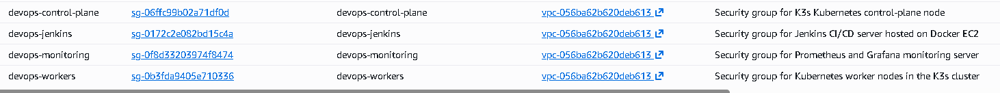
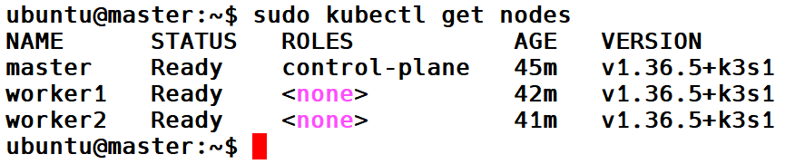

# Cloud-Native Retail DevOps Platform

A production-style cloud-native Retail Order Management Platform designed to practise real-world DevOps engineering using AWS, Docker, Jenkins, Kubernetes, GitOps and centralized monitoring.

**Project Status:** 🚧 In Progress

## 1. Project Overview

This project aims to build and operate a cloud-native retail application with automated CI/CD, container orchestration, infrastructure automation, security scanning and centralized observability.

The project is being implemented on AWS EC2 using a five-instance infrastructure.

## 2. Infrastructure Architecture

| EC2 Instance | Responsibility |
|---|---|
| Instance 1 | Docker and Jenkins CI/CD server |
| Instance 2 | K3s Control Plane |
| Instance 3 | K3s Worker Node 1 |
| Instance 4 | K3s Worker Node 2 |
| Instance 5 | Dedicated Monitoring Server |

All five instances are deployed within the same AWS VPC, across different subnets and Availability Zones, using separate security groups according to their responsibilities.

<br><br>
## **EC2 Instances:**
<br><br>


<br><br>

## **VPC architecture:**
<br><br>


<br><br>

## **Security Groups:**
<br><br>


<br><br>

## **K3s Cluster:**
<br><br>



## 3. Technology Stack

| Category | Technologies |
|---|---|
| Cloud | AWS EC2, VPC, IAM, ECR |
| Operating System | Ubuntu |
| Containerization | Docker |
| CI/CD | Jenkins |
| Orchestration | K3s / Kubernetes |
| Infrastructure as Code | Terraform |
| GitOps | Argo CD |
| Security | Trivy |
| Monitoring | Prometheus, Grafana, Alertmanager |
| Logging | Loki |
| Application Data | PostgreSQL, Redis |
| Messaging | RabbitMQ |
| Source Control | GitHub |

## 4. Implementation Progress

### Completed

- AWS EC2 infrastructure provisioned.
- Five-instance architecture established.
- Separate security groups configured for infrastructure roles.
- Three-node K3s cluster established.
- Two worker nodes successfully registered with the control plane.
- Kubernetes system components verified.
- Docker installed and running on the CI/CD server.
- Java 21 installed.
- Jenkins LTS installed and running as a system service.

### Planned

- Jenkins initial configuration and Docker integration.
- GitHub integration.
- Amazon ECR setup.
- Automated Jenkins CI pipeline.
- Trivy image vulnerability scanning.
- Argo CD GitOps implementation.
- Retail microservices application development.
- Kubernetes application deployment.
- Ingress and external traffic management.
- Prometheus and Grafana monitoring.
- Centralized logging with Loki.
- Backup, security and disaster-recovery testing.

## 5. Target Application

The planned Retail Order Management Platform will include:

- Product Catalog Service
- Order Management Service
- Inventory Service
- Payment Simulation Service
- Notification Service
- Customer Frontend

Supporting infrastructure will include PostgreSQL, Redis and RabbitMQ.

## 6. Repository Structure

```text
cloud-native-retail-devops-platform/
├── README.md
├── architecture/
├── screenshots/
├── infrastructure/
│   └── terraform/
├── application/
├── jenkins/
├── kubernetes/
├── argocd/
├── monitoring/
└── documentation/
```

## 7. Learning Objectives

- Design AWS infrastructure for a cloud-native application.
- Implement CI/CD automation using Jenkins.
- Build and secure Docker images.
- Deploy microservices to Kubernetes.
- Implement GitOps using Argo CD.
- Monitor infrastructure and applications.
- Troubleshoot real-world deployment and infrastructure failures.

---

**Note:** This is an actively evolving hands-on project. Implementation status will be updated as each phase is completed.
